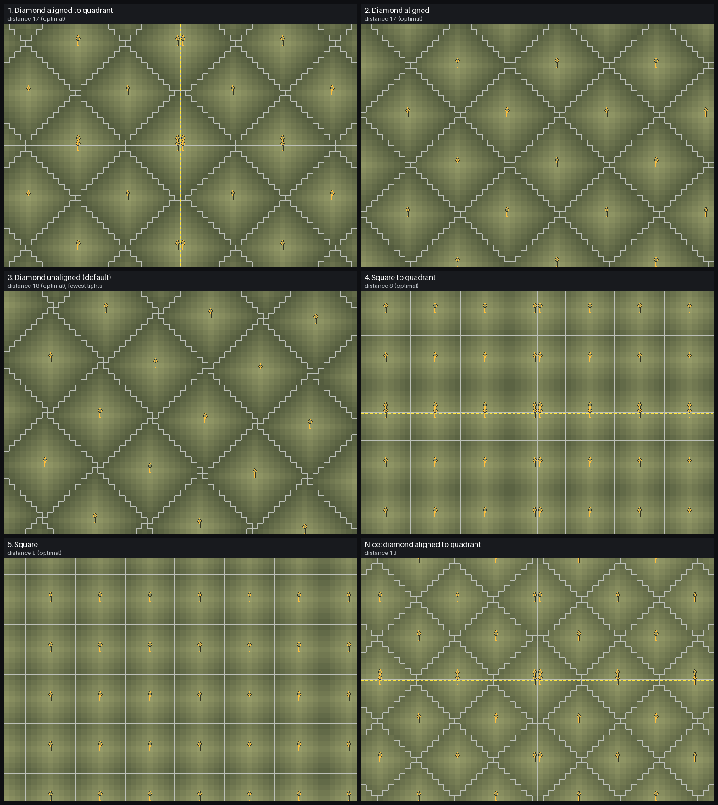
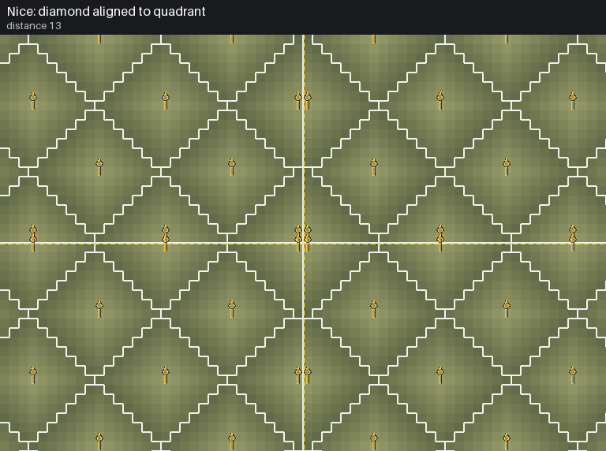

# Light Overlay

A client-side [Necesse](https://store.steampowered.com/app/1169040/Necesse/) mod that highlights tiles that are dark enough for hostile mobs to spawn.

- Toggle with **F8** (rebindable in controls) or the `/lightoverlay` chat command.
- Change the overlay opacity with `/lightoverlayalpha <0-1>`.

## Installing

Copy `dist/Light_Overlay-<game version>-<mod version>.jar` into Necesse's `mods` folder (create it if missing), then
enable the mod in the game's Mods menu. Unsubscribe from the Steam Workshop copy of Light Overlay first, since it uses
the same mod ID.

- Windows: `%APPDATA%\Necesse\mods\`
- Linux: `~/.config/Necesse/mods/`
- macOS: `~/Library/Application Support/Necesse/mods/`

## Torch grid

`/lightoverlaygrid` shows where light sources belong. White borders mark the area each light is responsible for, and
each spot gets a torch outline: **green** = a torch is there, **orange** = mobs can spawn in that area, so a torch
belongs here, **white** = the area is already lit.

### Layouts

On open ground a regular torch (light 150) keeps every tile within 9 steps lit above the spawn threshold of 50, since
light drops 10 per tile. Each layout's default spacing is the widest that still leaves no spawnable tile.



| # | `/lightoverlaylayout` | Shape | Optimal distance | Tiles per torch |
|---|---|---|---|---|
| 1 | `diamondquadrant` | Diamonds aligned to the quadrants, mirrored at the quadrant lines | 17 | 162 (less near the lines) |
| 2 | `diamondaligned` | Torches in rows, every other row shifted by half | 17 | 162 |
| 3 | `diamond` (default) | Skewed diamonds: every tile covered exactly once, the fewest torches | 18 | 181 |
| 4 | `squarequadrant` | Square grid mirrored at the quadrant lines | 8 | 81 (less near the lines) |
| 5 | `square` | Torches line up in rows and columns | 8 | 81 |

**Light source distance** is how many tiles are between neighbouring light sources (13 means a light every 14th tile).
Set it with `/lightoverlaydistance <tiles>`; `0` (the default) uses the optimal distance for the layout. Diamond
layouts need an even or odd step, so an in-between value rounds down to the next tighter spacing.

**Quadrant layouts** split the world into four quadrants around a center and start each quadrant's grid at its corner
tile, stopping at the quadrant lines. Lights pair up on both sides of each line, which leaves a lit path along it.

**Nice preset:** `/lightoverlaynice` sets layout 1 with a distance of 13: rows of torches 14 tiles apart, rows 7 apart.



### Grid origin

- Non-quadrant layouts start at tile (0, 0).
- Quadrant layouts center on (150, 150), so the quadrant corners are tiles 149,149 / 150,149 / 149,150 / 150,150.
- Worlds migrated from the island versions (before 1.0) keep the old home island at tiles 0-299, so every layout
  centers on (150, 150) there. Migration can only be detected when the world runs on your computer (singleplayer or
  hosting); on someone else's server, set the origin yourself.
- `/lightoverlayorigin [tileX tileY]` sets the origin for the current world (your current tile if no coordinates are
  given). `/lightoverlayoriginreset` goes back to the default, and `/lightoverlaygridinfo` shows what's in use.

## Auto torch

Off by default. Turn it on with `/lightoverlayautotorch` (or `autotorch = true` in the mod's config).
While it's on, regular torches from your inventory are placed for you on the torch grid, one at a time, whenever you
aren't using an item. It works from your character's position, so you don't need to point the cursor at the spot:
any grid spot within torch placing reach gets filled.

- It finds the darkest tile in reach where mobs can spawn and places a torch on the grid spot that covers it.
  If that spot can't hold a torch (wall, water, furniture...), the torch goes on the dark tile itself.
- **Relocation** (`/lightoverlayrelocate`, on by default while auto torch is on): regular torches that are off the grid
  get moved onto it. The new torch is placed first, then the old one is mined with a pickaxe or axe from your
  inventory. Torches whose grid spot is blocked or already has a torch are left alone, since they're filling a gap.

Placements and mining go through the normal player actions, so the server checks them like your own and they work in
multiplayer. Only plain torches are placed or moved; wall torches, lanterns and other lights are never touched.

## Commands

All settings are saved as soon as they change.

| Command | Does |
|---|---|
| `/lightoverlay [1/0]` (or **F8**) | Toggle the spawn overlay |
| `/lightoverlayalpha <0-1>` | Overlay opacity |
| `/lightoverlaygrid [1/0]` | Toggle the torch grid |
| `/lightoverlaylayout <layout>` | Torch layout (see above) |
| `/lightoverlaydistance <tiles>` | Tiles between light sources, 0 = optimal |
| `/lightoverlaynice` | Nice preset: `diamondquadrant`, distance 13 |
| `/lightoverlayorigin [tileX tileY]` | Grid origin for this world (default: your tile) |
| `/lightoverlayoriginreset` | Default origin for this world |
| `/lightoverlaygridinfo` | Show layout, distance and origin |
| `/lightoverlayautotorch [1/0]` | Toggle auto torch |
| `/lightoverlayrelocate [1/0]` | Toggle moving off-grid torches |

## Building

Requires a JDK 17+ and a Steam install of Necesse. The game directory and game version are detected automatically
(override `gamePath` in `settings.gradle` if detection fails).

```bash
./gradlew buildModJar
```

The mod jar is written to `build/jar/`. Use `./gradlew runClient` to launch the game with the mod.

`tools/layout-diagrams/run.sh` tests the torch layouts and regenerates the diagrams in `docs/layouts/` (needs only a
JDK and Python with Pillow).

Check out the [modding wiki page](https://necessewiki.com/Modding) and the
[ExampleMod](https://github.com/DrFair/ExampleMod) for more.
